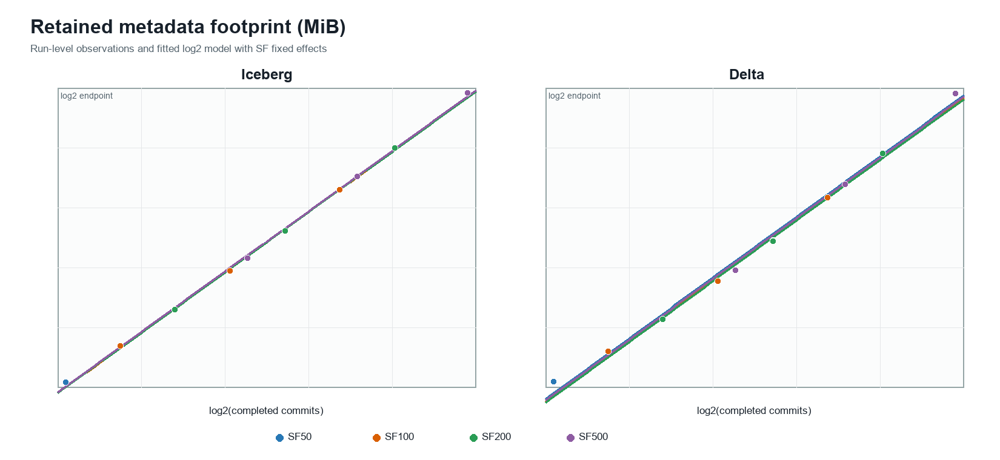
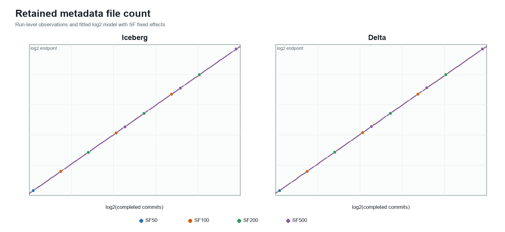
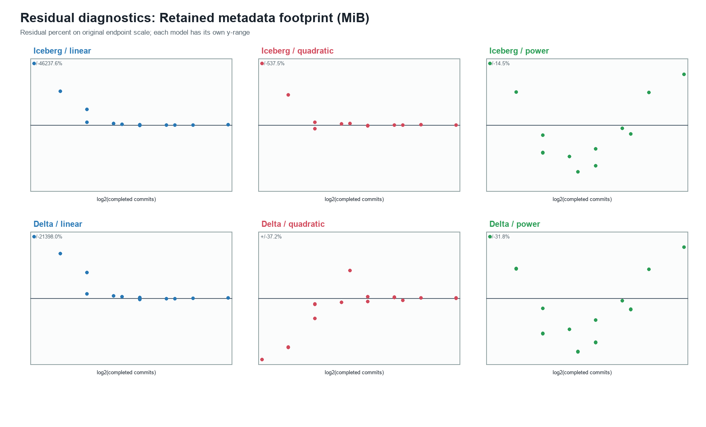
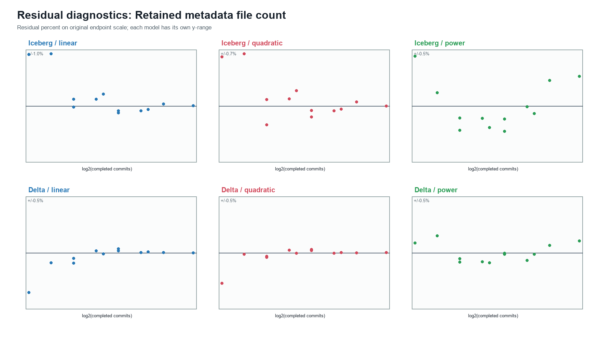

# Final Retained Metadata Footprint Analysis

Method version: `publication_metadata_growth_final_v1_0`  
Generated: 2026-10-25T17:11:22.130087Z  
Scope: 72 canonical physical ingestion runs, 36 per format  
Bootstrap: 10,000 stratified run-level draws; seed `20261025`

> The endpoint is the retained physical metadata-directory footprint immediately before native maintenance. It is not active metadata, query-planning work, or an economic cost.

## Integrity decision

All 35 locked and metadata-specific integrity checks passed before model fitting. The validated B10 reruns are included. The input exports and historical data were read only.

## Primary model

Each format is modeled separately with the locked equation:

`log2(metadata_total_size_mib_before) = alpha + eta*log2(completed_ingestion_commits) + SF_FE + error`

The independent unit is the physical ingestion run. SF50 is the reference category. The 95% intervals use BCa unless the locked fallback criteria require a percentile interval.

| Format | Runs | Eta | 95% CI | CI method | R2 log2 | Adjusted R2 log2 | Original-scale RMSE MiB |
|---|---:|---:|---:|---|---:|---:|---:|
| Delta | 36 | 1.739660 | [1.739590, 1.739730] | BCA | 0.994598 | 0.993901 | 747.14 |
| Iceberg | 36 | 1.873877 | [1.873860, 1.873893] | BCA | 0.999132 | 0.999019 | 1,163.33 |

Eta is an empirical elasticity conditional on SF and on the tested commit, retention, checkpoint, Spark, HDFS, and table-format settings. It is not a universal format constant.
The intervals are exceptionally narrow because the locked stratified bootstrap resamples only the three physical repetitions inside each fixed SF/MOPT cell, while the observed within-cell metadata endpoints are highly reproducible. They quantify conditional replication uncertainty, not uncertainty under different infrastructure or retention regimes.

## Metadata-file count

The same locked log2/SF-fixed-effects structure was applied to the secondary file-count endpoint.

| Format | File-count elasticity | 95% CI | CI method | R2 log2 | Original-scale RMSE files |
|---|---:|---:|---|---:|---:|
| Delta | 0.998930 | [0.998930, 0.998930] | BCA | 1.000000 | 3.08 |
| Iceberg | 0.998465 | [0.998465, 0.998465] | BCA | 0.999998 | 21.77 |

The file-count intervals collapse to the point estimates because all three repetitions have exactly the same metadata-file count in every SF/MOPT stratum. This is a degenerate conditional bootstrap distribution, not evidence that the relationship is uncertainty-free under other retention or infrastructure conditions.

## Complementary model and residual analysis

Linear and quadratic models use the original endpoint scale and commits in thousands. The power model uses log2 endpoint and log2 commits. All include the same SF fixed effects and all 36 runs per format. Original-scale RMSE and leave-one-run-out RMSE are supplied for descriptive comparison; native-response AIC/BIC must not be compared across original-scale and log-scale response models.

### Retained metadata size

| Format | Model | R2 original | Adjusted R2 original | RMSE MiB | LOOCV RMSE MiB | Max residual % | Nonpositive fits | Residual/fitted correlation |
|---|---|---:|---:|---:|---:|---:|---:|---:|
| Iceberg | linear | 0.936972 | 0.928839 | 2,490.78 | 2,948.19 | 42,812.61 | 21 | 0.0000 |
| Iceberg | quadratic | 0.999995 | 0.999994 | 22.42 | 27.11 | 497.72 | 6 | 0.0000 |
| Iceberg | power | 0.986251 | 0.984477 | 1,163.33 | 1,359.26 | 13.40 | 0 | 0.9947 |
| Delta | linear | 0.936519 | 0.928328 | 724.28 | 857.47 | 19,812.98 | 21 | 0.0000 |
| Delta | quadratic | 0.999998 | 0.999998 | 3.57 | 4.42 | 34.48 | 0 | 0.0000 |
| Delta | power | 0.932448 | 0.923732 | 747.14 | 861.16 | 29.44 | 0 | 0.9914 |

The linear and, at the smallest footprints, quadratic original-scale fits can produce nonphysical predictions near or below zero. This explains their extreme percentage residuals despite a small absolute error for the quadratic model. The power fit guarantees positive predictions and describes relative scaling, whereas the quadratic fit describes absolute curvature over the observed range. Neither is promoted to a universal asymptotic law.

### Metadata file count

| Format | Model | R2 original | Adjusted R2 original | RMSE files | LOOCV RMSE files | Max residual % | Nonpositive fits | Residual/fitted correlation |
|---|---|---:|---:|---:|---:|---:|---:|---:|
| Iceberg | linear | 1.000000 | 1.000000 | 2.96 | 3.42 | 0.96 | 0 | 0.0000 |
| Iceberg | quadratic | 1.000000 | 1.000000 | 2.74 | 3.34 | 0.67 | 0 | 0.0000 |
| Iceberg | power | 0.999991 | 0.999990 | 21.77 | 25.69 | 0.44 | 0 | 0.9477 |
| Delta | linear | 1.000000 | 1.000000 | 0.17 | 0.19 | 0.35 | 0 | 0.0000 |
| Delta | quadratic | 1.000000 | 1.000000 | 0.13 | 0.15 | 0.27 | 0 | -0.0000 |
| Delta | power | 0.999999 | 0.999999 | 3.08 | 3.63 | 0.15 | 0 | 0.9341 |

## Reconciliation with the previous power exponents

| Format | Previous exponent | Exactly reproduced | Final SF-adjusted eta | Difference |
|---|---:|---:|---:|---:|
| Delta | 1.7343 | 1.7343 | 1.7397 | 0.0054 |
| Iceberg | 1.8747 | 1.8747 | 1.8739 | -0.0009 |

The earlier exponents are exactly reproducible from the same canonical measurements. They came from an unadjusted power fit over twelve SF/MOPT scenario means. The final model instead uses all 36 physical runs per format and controls SF categorically. Any difference is therefore caused by the locked estimand and model design, not by replacing the data. Because commit count is largely generated by SF/MOPT, the unadjusted exponent partly mixes commit scaling with scale-factor level differences.

## Technical interpretation

- Iceberg counts every regular file recursively retained under the table `metadata/` directory. Frequent commits create snapshots, manifest lists, manifests, and progressively larger table metadata JSON versions. Old physical metadata versions remained retained under the tested defaults.
- Delta counts transaction-log JSON files and checkpoint-named files under `_delta_log/`. Incremental commit JSONs accumulate, while the default ten-commit cadence retains repeated full-state checkpoints that grow with table state during these short runs.
- Consequently, superlinear retained-byte growth can coexist with an approximately linear growth in metadata-file count. File count and bytes represent different accumulation mechanisms.

## Interpretation limits

1. The endpoint is a physically retained directory footprint, not the minimum metadata required to reconstruct the current table and not active query-planning input.
2. The formats count different native object classes. A cross-format byte ratio is not a like-for-like metadata-object efficiency comparison.
3. Commit count, SF, and MOPT are structurally related. SF fixed effects reduce one source of confounding but do not turn eta into a causal or universal law.
4. No historical file-type split is reconstructed for overwritten table directories. Aggregate historical measurements are used without estimating unavailable composition.
5. The quadratic model is a descriptive fit over the observed commit range. Compatibility with quadratic growth does not establish an asymptotic O(C^2) law outside that range.
6. The three repetitions per SF/MOPT cell limit uncertainty precision. Bootstrap draws preserve the physical-run unit and do not treat metadata files or commits as independent experiments.
7. This analysis contains no economic valuation or cost model.

## Reproducibility artifacts

- `metadata_growth_run_level.csv`: canonical run-level inputs and endpoints.
- `metadata_growth_cell_summary.csv`: mean, SD, and CV across the three physical repetitions.
- `metadata_growth_primary_elasticities.csv`: eta estimates and locked intervals.
- `metadata_growth_primary_coefficients.csv`: complete SF-fixed-effects coefficients.
- `metadata_growth_secondary_model_comparison.csv`: linear, quadratic, and power diagnostics.
- `metadata_growth_model_residuals.csv`: run-level fitted values and residuals.
- `metadata_growth_prior_power_model_reconciliation.csv`: exact reproduction of the earlier exponents.
- `metadata_growth_bootstrap_diagnostics.csv`: BCa/fallback diagnostics.
- `integrity_checks.csv`: locked input and metadata-specific validation gates.
- `analysis_run_manifest.json`: hashes and runtime versions.
