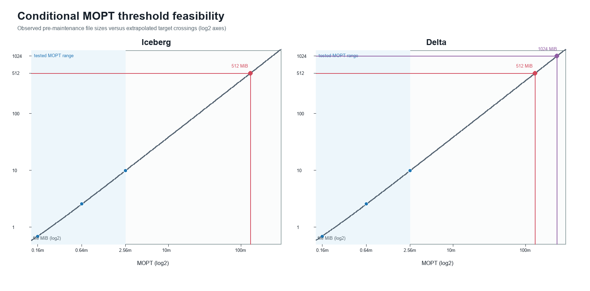

# Conditional MOPT Threshold Feasibility

Method version: `publication_mopt_threshold_feasibility_v1_0`  
Generated: 2026-10-25T17:17:45.780512Z  
Scope: 72 canonical runs, including the validated B10 reruns  
Tested MOPT range: 160,000 to 2,560,000 records per trigger  
Bootstrap: 10,000 stratified physical-run draws; seed `20261025`

> This report assesses a conditional engineering threshold. It neither proposes an optimization method nor presents an economic cost model.

## Integrity and measurement boundary

All 35 locked and threshold-specific integrity checks passed before calculation. The file-size endpoint is the table-wide arithmetic mean `total_data_size_mib_before / data_file_count_before`, recorded immediately before native maintenance. Post-maintenance means are reported only as contextual evidence; they are not used to fit the ingestion-side threshold.

## 1. Empirically observed file-size range

Each cell contains three independent physical runs. Replication SD is zero within numerical precision in all 24 pre-maintenance SF/MOPT/file-format cells.

| Format | SF | MOPT | Pre-maintenance mean MiB | Post-maintenance mean MiB |
|---|---:|---:|---:|---:|
| Delta | 50 | 160,000 | 0.671 | 780.950 |
| Delta | 50 | 640,000 | 2.520 | 892.524 |
| Delta | 50 | 2,560,000 | 9.647 | 892.305 |
| Delta | 100 | 160,000 | 0.676 | 837.559 |
| Delta | 100 | 640,000 | 2.539 | 897.498 |
| Delta | 100 | 2,560,000 | 9.781 | 897.285 |
| Delta | 200 | 160,000 | 0.681 | 873.778 |
| Delta | 200 | 640,000 | 2.562 | 905.168 |
| Delta | 200 | 2,560,000 | 9.905 | 938.508 |
| Delta | 500 | 160,000 | 0.684 | 869.842 |
| Delta | 500 | 640,000 | 2.571 | 934.064 |
| Delta | 500 | 2,560,000 | 9.918 | 962.180 |
| Iceberg | 50 | 160,000 | 0.671 | 431.169 |
| Iceberg | 50 | 640,000 | 2.520 | 456.804 |
| Iceberg | 50 | 2,560,000 | 9.672 | 450.329 |
| Iceberg | 100 | 160,000 | 0.676 | 447.536 |
| Iceberg | 100 | 640,000 | 2.539 | 459.470 |
| Iceberg | 100 | 2,560,000 | 9.807 | 471.987 |
| Iceberg | 200 | 160,000 | 0.681 | 450.443 |
| Iceberg | 200 | 640,000 | 2.562 | 472.007 |
| Iceberg | 200 | 2,560,000 | 9.930 | 484.621 |
| Iceberg | 500 | 160,000 | 0.683 | 449.680 |
| Iceberg | 500 | 640,000 | 2.571 | 478.298 |
| Iceberg | 500 | 2,560,000 | 9.944 | 483.825 |

Across all runs, pre-maintenance averages span 0.671-9.944 MiB for Iceberg and 0.671-9.918 MiB for Delta. The tested ingestion configurations therefore remain far below both declared target sizes.

## 2. Target-size coverage

| Format | Target role | Target MiB | Pre range MiB | Max pre as % target | In pre range? | Post range MiB | Max post as % target | In post range? | All post means >= target? |
|---|---|---:|---:|---:|---|---:|---:|---|---|
| Iceberg | native_512_mib | 512 | 0.671-9.944 | 1.94% | No | 431.161-484.865 | 94.70% | No | No |
| Delta | harmonized_512_mib | 512 | 0.671-9.918 | 1.94% | No | 780.918-962.186 | 187.93% | No | Yes |
| Delta | native_1024_mib | 1,024 | 0.671-9.918 | 0.97% | No | 780.918-962.186 | 93.96% | No | No |

The 512 MiB harmonized target and the native 512 MiB Iceberg target are outside the observed pre-maintenance range. Delta's native 1 GiB target is also outside it. Native maintenance moves the averages toward, but not through, the corresponding native targets: Iceberg reaches 431.161-484.865 MiB and Delta 780.918-962.186 MiB. Delta therefore exceeds the harmonized 512 MiB comparison target after `OPTIMIZE` in every run, but this maintenance outcome does not validate an ingestion-side MOPT threshold. A configured target is a packing objective or upper sizing parameter, not a guarantee that the arithmetic mean equals that value.

## 3. Structural model and conditional threshold

The already published structural relationship is:

`expected_file_size = delta_parquet + (MOPT * mean_row_bytes * compression_factor) / output_partitions`

with `output_partitions = 12`. Solving it algebraically for a declared target gives:

`MOPT_star = output_partitions * (F_target - delta_parquet) / (mean_row_bytes * compression_factor)`

The model parameters below are estimated separately by format from all 36 canonical runs. The intercept is an empirical regression intercept; it must not be interpreted as a direct physical measurement of Parquet header bytes.

| Format | Delta parquet MiB | Slope MiB / million MOPT | Implied payload product bytes/record | R2 | RMSE MiB |
|---|---:|---:|---:|---:|---:|
| Iceberg | 0.086098 | 3.811233 | 47.956 | 0.999715 | 0.0667 |
| Delta | 0.090550 | 3.799716 | 47.811 | 0.999709 | 0.0672 |

| Format | Target role | Target MiB | Conditional MOPT* | 95% interval | Multiple of tested maximum | Classification |
|---|---|---:|---:|---:|---:|---|
| Iceberg | native_512_mib | 512 | 134,317,129 | [134,317,129, 134,317,129] | 52.5x | MODEL_EXTRAPOLATION |
| Delta | harmonized_512_mib | 512 | 134,723,073 | [134,723,073, 134,723,073] | 52.6x | MODEL_EXTRAPOLATION |
| Delta | native_1024_mib | 1,024 | 269,469,977 | [269,469,977, 269,469,977] | 105.3x | MODEL_EXTRAPOLATION |

The point calculations and their intervals are mathematical consequences of the fitted structural line. They are not experimentally validated threshold locations. All crossings occur more than fifty times above the maximum tested MOPT; the Delta 1 GiB crossing is more than one hundred times above it. The bootstrap intervals are exceptionally narrow because pre-maintenance cell means are identical across the three repetitions. This conditional replication precision does not reduce extrapolation uncertainty, model-form uncertainty, memory risk, partition skew, or the likelihood that such large triggers change Spark's execution regime.

## 4. When does the formula imply that compaction remains necessary?

The formula supports only the following conditional statement: if a chosen target file size is an actual system requirement, if each non-empty micro-batch writes approximately one immutable file per active source partition, if files are not coalesced across batches during ingestion, and if the stable schema/codec/row-size relationship continues to hold, then `MOPT < MOPT_star` implies that ingestion alone is expected to produce files below the target and a later cross-batch rewrite is required to reach that sizing objective.

That statement additionally assumes:

1. approximately twelve active and reasonably balanced Kafka/output partitions per full micro-batch;
2. unchanged TPC-DS schema, row-size distribution, ZSTD behavior, Spark writer, and Parquet overhead regime;
3. no optimized write, auto-compaction, adaptive repartitioning, or writer-side cross-batch clustering;
4. sufficiently full batches, with tail batches and partition skew treated as departures from the expectation;
5. a target below neither the fitted intercept nor the practical storage/writer limits;
6. an operational reason to require the target, such as demonstrated query or file-management benefit.

Average file size below a nominal target does not by itself prove that compaction is operationally required. Conversely, even `MOPT >= MOPT_star` would not guarantee that every file reaches the target, because skew, partial final batches, task retries, and writer behavior create a distribution of file sizes.

## 5. Evidence classification

| Statement | Classification | Scientific status |
|---|---|---|
| Average pre-maintenance file size increases monotonically across the tested MOPT grid | Empirical finding | Supported by all 72 canonical runs |
| Pre-maintenance means are 0.671-9.944 MiB | Empirical finding | Directly observed |
| The published affine file-size formula can be solved for MOPT* when slope is positive and target exceeds the intercept | Mathematical derivation | Algebraically valid under model assumptions |
| Conditional crossings are approximately 134 million records for 512 MiB and 269 million for Delta 1 GiB | Model calculation | Reproducible but extrapolated |
| Those MOPT values will produce the targets on this cluster | Experimental claim | Not validated; prohibited |
| Compaction is required for all workloads below MOPT* | Universal operational claim | Not supported; depends on declared objective and workload benefit |
| The targets are optimal | Optimization claim | Not evaluated and not supported |

## Final feasibility judgment

The conditional threshold is scientifically usable as an algebraic scenario calculation and as a way to show how far the tested ingestion regime lies from native large-file targets. It is not empirically validated as a configuration threshold. The current experiment supports the direction and near-linear local relationship between MOPT and average file size, but both 512 MiB and 1 GiB crossings lie far outside the observed MOPT and file-size ranges. Therefore, the journal article may report MOPT* only as a clearly labeled, assumption-dependent extrapolation. It must not present the computed values as tested recommendations, universal optima, or evidence that compaction becomes unnecessary at those settings.

## Reproducibility artifacts

- `mopt_threshold_run_level.csv`: 72 canonical run-level observations.
- `mopt_threshold_cell_summary.csv`: all 24 SF/MOPT/format cells with replication spread.
- `mopt_threshold_structural_models.csv`: fitted structural parameters and diagnostics.
- `mopt_threshold_estimates.csv`: target crossings, intervals, and extrapolation factors.
- `mopt_target_range_assessment.csv`: observed-range checks before and after maintenance.
- `mopt_threshold_bootstrap_diagnostics.csv`: locked BCa diagnostics.
- `integrity_checks.csv`: canonical and threshold-specific gates.
- `analysis_run_manifest.json`: input/output hashes and runtime versions.
