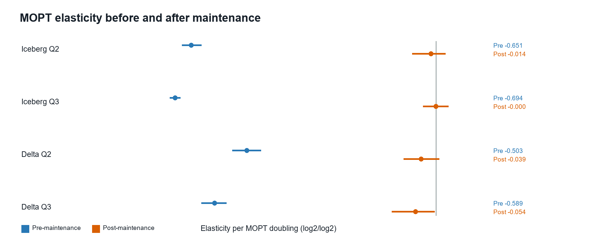
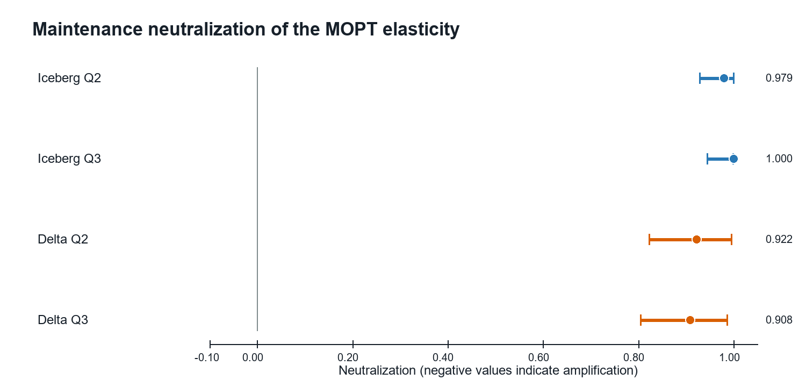

# Final Query-Neutralization Results

Analysis method: `publication_final_statistical_analysis_v1_0`  
Generated: 2026-10-25T16:43:52.663843Z  
Canonical runs: 72 (36 Iceberg, 36 Delta)  
Bootstrap: 10,000 paired, cell-stratified run-level draws; seed `20261025`

## Integrity decision

All 29 locked integrity checks passed before model execution. No raw file was changed, no run was substituted, and no terminal n-1 batch metric was imputed.

## Primary results

The response is `log2` of the arithmetic mean of the three measured query wall times. Slopes are elasticities per MOPT doubling. Confidence intervals are BCa unless the table explicitly identifies the locked percentile fallback.

| Format | Query | beta_pre (95% CI) | beta_post (95% CI) | Difference post-pre (95% CI) | Neutralization (95% CI; method) | Holm p | Decision flags |
|---|---|---:|---:|---:|---:|---:|---|
| Iceberg | Q2 | -0.651 [-0.675, -0.624] | -0.014 [-0.063, 0.025] | 0.637 [0.601, 0.671] | 0.9791 [0.9292, 0.9996]; BCA | 4.312e-21 | STABLE; SAME_SIGN_OR_ZERO; SUPPORTED_NEUTRALIZATION |
| Iceberg | Q3 | -0.694 [-0.708, -0.680] | -0.000 [-0.035, 0.032] | 0.694 [0.665, 0.723] | 0.9999 [0.9449, 0.9992]; PERCENTILE_FALLBACK | 2.713e-25 | STABLE; SAME_SIGN_OR_ZERO; SUPPORTED_NEUTRALIZATION |
| Delta | Q2 | -0.503 [-0.541, -0.466] | -0.039 [-0.086, 0.009] | 0.464 [0.393, 0.527] | 0.9219 [0.8224, 0.9951]; BCA | 1.452e-11 | STABLE; SAME_SIGN_OR_ZERO; SUPPORTED_NEUTRALIZATION |
| Delta | Q3 | -0.589 [-0.624, -0.558] | -0.054 [-0.117, -0.004] | 0.535 [0.478, 0.583] | 0.9080 [0.8049, 0.9867]; BCA | 3.491e-16 | STABLE; SAME_SIGN_OR_ZERO; SUPPORTED_NEUTRALIZATION |

## Interpretation

Maintenance met every locked criterion for a primary neutralization claim in **4 of 4** format/query combinations.
Supported combinations: Iceberg Q2, Iceberg Q3, Delta Q2, Delta Q3.

Estimated neutralization was Iceberg Q2: 97.9%; Iceberg Q3: 100.0%; Delta Q2: 92.2%; Delta Q3: 90.8%.

The post-maintenance slope interval includes zero for Iceberg Q2, Iceberg Q3, Delta Q2. A residual slope remains distinguishable from zero for Delta Q3. This distinguishes near-complete neutralization from proof that the post-maintenance effect is exactly zero.

A statistically detectable pre/post slope change is not by itself sufficient: the absolute slope must decrease, the pre-maintenance denominator must be stable, and a sign reversal must not contradict the magnitude-based ratio.

## Sensitivity analyses

The locked sensitivity analyses use median aggregation, an Iceberg warm-cache-only subset, SF-specific exploratory models, and Q1 as a secondary control. They do not form new confirmatory multiplicity families.

| Analysis | Scope | Format | Query | Runs | beta_pre | beta_post | Neutralization | Denominator |
|---|---|---|---|---:|---:|---:|---:|---|
| median_sensitivity | all_canonical | Iceberg | Q2 | 36 | -0.645 | -0.026 | 0.960 | STABLE |
| median_sensitivity | all_canonical | Iceberg | Q3 | 36 | -0.698 | 0.010 | 0.985 | STABLE |
| median_sensitivity | all_canonical | Delta | Q2 | 36 | -0.521 | -0.019 | 0.963 | STABLE |
| median_sensitivity | all_canonical | Delta | Q3 | 36 | -0.597 | -0.053 | 0.911 | STABLE |
| warm_cache_sensitivity | warm_cache_only | Iceberg | Q2 | 31 | -0.670 | -0.014 | 0.979 | STABLE |
| warm_cache_sensitivity | warm_cache_only | Iceberg | Q3 | 31 | -0.708 | -0.009 | 0.987 | STABLE |
| warm_cache_sensitivity | identical_to_primary_all_delta_rows_warm_cache | Delta | Q2 | 36 | -0.503 | -0.039 | 0.922 | STABLE |
| warm_cache_sensitivity | identical_to_primary_all_delta_rows_warm_cache | Delta | Q3 | 36 | -0.589 | -0.054 | 0.908 | STABLE |
| q1_secondary | all_canonical | Iceberg | Q1 | 36 | -0.353 | 0.111 | 0.684 | STABLE |
| q1_secondary | all_canonical | Delta | Q1 | 36 | -0.157 | -0.096 | 0.384 | STABLE |
| sf_specific_exploratory | SF50 | Iceberg | Q2 | 9 | -0.521 | -0.009 | 0.983 | STABLE |
| sf_specific_exploratory | SF50 | Iceberg | Q3 | 9 | -0.595 | -0.007 | 0.988 | STABLE |
| sf_specific_exploratory | SF100 | Iceberg | Q2 | 9 | -0.644 | -0.044 | 0.931 | STABLE |
| sf_specific_exploratory | SF100 | Iceberg | Q3 | 9 | -0.680 | -0.012 | 0.983 | STABLE |
| sf_specific_exploratory | SF200 | Iceberg | Q2 | 9 | -0.699 | 0.033 | 0.953 | STABLE |
| sf_specific_exploratory | SF200 | Iceberg | Q3 | 9 | -0.730 | 0.047 | 0.935 | STABLE |
| sf_specific_exploratory | SF500 | Iceberg | Q2 | 9 | -0.740 | -0.034 | 0.954 | STABLE |
| sf_specific_exploratory | SF500 | Iceberg | Q3 | 9 | -0.770 | -0.029 | 0.962 | STABLE |
| sf_specific_exploratory | SF50 | Delta | Q2 | 9 | -0.437 | -0.153 | 0.651 | STABLE |
| sf_specific_exploratory | SF50 | Delta | Q3 | 9 | -0.527 | -0.117 | 0.777 | STABLE |
| sf_specific_exploratory | SF100 | Delta | Q2 | 9 | -0.377 | 0.046 | 0.879 | STABLE |
| sf_specific_exploratory | SF100 | Delta | Q3 | 9 | -0.445 | 0.081 | 0.818 | STABLE |
| sf_specific_exploratory | SF200 | Delta | Q2 | 9 | -0.563 | -0.045 | 0.919 | STABLE |
| sf_specific_exploratory | SF200 | Delta | Q3 | 9 | -0.668 | -0.036 | 0.946 | STABLE |
| sf_specific_exploratory | SF500 | Delta | Q2 | 9 | -0.636 | -0.005 | 0.992 | STABLE |
| sf_specific_exploratory | SF500 | Delta | Q3 | 9 | -0.716 | -0.144 | 0.798 | STABLE |

Sensitivity summary:

- Median aggregation retained a large reduction in absolute MOPT slope in all four combinations; Iceberg Q3 crossed slightly above zero after maintenance and is therefore flagged as a sign reversal rather than silently treated as ordinary neutralization.
- The Iceberg warm-cache-only estimates remained close to the all-run estimates: Q2 97.9%, Q3 98.7%.
- SF-specific exploratory neutralization estimates ranged from 65.1% to 99.2%. These n=9 models are descriptive, and several show a post-maintenance sign reversal.
- Q1 remained secondary: Iceberg 68.4%, Delta 38.4%. Iceberg Q1 shows a sign reversal, consistent with the locked caution for the metadata-oriented control query.

## Method diagnostics

- Primary BCa fallbacks across reported primary metric intervals: 2.
- Primary combinations with an unstable or non-estimable beta_pre denominator: 0.
- Holm correction covers exactly Iceberg/Delta crossed with Q2/Q3.
- The primary model includes SF fixed effects and phase-by-SF interactions and clusters covariance by physical run.
- The warm-cache-only Iceberg analysis contains 31 runs and omits the complete B02 cell; its bootstrap preserves the observed eligible stratum sizes rather than manufacturing replacement runs.

## Limitations

1. Three physical replications per SF/MOPT cell limit precision; bootstrap draws do not create independent evidence.
2. Five Iceberg runs are labeled `cache_mode=none`. They remain in the primary paired analysis, but equal cache state is not claimed.
3. The warm-cache-only subset is unbalanced and entirely lacks Iceberg B02 (SF50/MOPT640000).
4. Query wall time is the format-neutral endpoint. Missing Iceberg EventLogs prevent symmetric planning/scan decomposition.
5. Native Iceberg and Delta maintenance operations are not algorithmically identical; conclusions concern their observed native pre/post effects.
6. The results apply to the tested Spark 3.5.0, Iceberg 1.6.1, Delta 3.2.0, Kafka, and HDFS configuration.
7. This final analysis specification was locked after data collection and exploratory work; it is not a pre-experiment preregistration.

## Reproducibility artifacts

- `integrity_checks.csv`: all pre-model gates.
- `query_run_level_aggregates.csv`: the 72-run paired analysis input after technical-repetition aggregation.
- `primary_neutralization_results.csv`: full primary estimates and tests.
- `sensitivity_neutralization_results.csv`: median, cache, SF-specific, and Q1 results.
- `bootstrap_interval_diagnostics.csv`: BCa/fallback diagnostics for every interval.
- `primary_bootstrap_estimates.csv`: all 10,000 primary bootstrap draws.
- `analysis_run_manifest.json`: input/output hashes and software environment.
