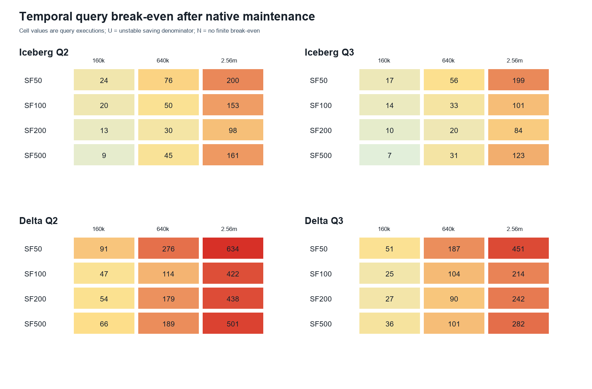
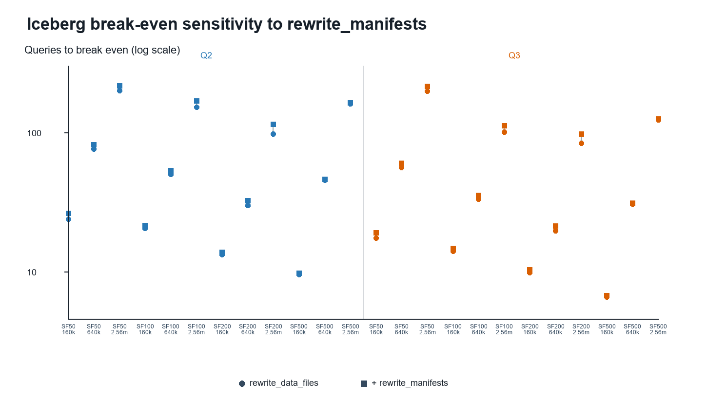

# Temporal Query Break-Even Results

Method version: `publication_query_break_even_v1_0`  
Generated: 2026-10-25T16:58:16.762652Z  
Scope: 72 canonical runs; Q2 and Q3; 24 SF/MOPT cells per primary maintenance boundary  
Bootstrap: 10,000 paired run-level draws per cell; seed `20261025`

> This is a temporal amortization analysis measured in future query executions. It is not an economic cost model.

## Integrity decision

All 32 locked canonical-data checks passed before calculation. The validated B10 reruns are included. No source row was altered or imputed.

## Definition

For each format/SF/MOPT/query cell, the three physical runs are the independent replications. Each run contributes the arithmetic mean of its three measured query repetitions before and after maintenance.

`mean saving = mean(pre query time - post query time)`

`break-even queries = mean(maintenance wall time) / mean saving`

All three run-level savings enter the mean, including zero or negative values. A nonpositive cell mean yields `NO_FINITE_BREAK_EVEN`. A positive mean whose bootstrap interval includes zero yields `UNSTABLE_SAVING_DENOMINATOR` and no break-even confidence interval.

Primary maintenance boundaries are Iceberg `rewrite_data_files` and Delta `optimize`. Iceberg additionally reports the locked sensitivity using `rewrite_data_files + rewrite_manifests`.

## Primary status summary

| Format | Query | Status | Cells |
|---|---|---|---:|
| Delta | Q2 | ESTIMABLE | 12 |
| Delta | Q3 | ESTIMABLE | 12 |
| Iceberg | Q2 | ESTIMABLE | 12 |
| Iceberg | Q3 | ESTIMABLE | 12 |

## Primary cell results

Times are milliseconds. Break-even is the number of subsequent executions of the indicated query.

| Format | SF | MOPT | Query | Mean pre | Mean post | Mean saving (95% CI) | Mean maintenance | Break-even (95% CI) | Status | Replication CV: saving / maintenance |
|---|---:|---:|---|---:|---:|---:|---:|---:|---|---:|
| Delta | 50 | 160000 | Q2 | 2,771.4 | 984.3 | 1,787.1 [1,286.3, 2,696.0] | 162,400.0 | 90.9 [64.8, 126.7] | ESTIMABLE | 0.447 / 0.141 |
| Delta | 50 | 640000 | Q2 | 1,143.3 | 678.4 | 464.9 [436.3, 495.3] | 128,430.0 | 276.3 [238.3, 300.3] | ESTIMABLE | 0.064 / 0.095 |
| Delta | 50 | 2560000 | Q2 | 808.1 | 627.4 | 180.7 [138.0, 222.3] | 114,596.3 | 634.3 [511.1, 747.4] | ESTIMABLE | 0.233 / 0.029 |
| Delta | 100 | 160000 | Q2 | 3,703.8 | 794.4 | 2,909.3 [2,794.3, 3,039.3] | 138,053.0 | 47.5 [45.2, 49.7] | ESTIMABLE | 0.042 / 0.006 |
| Delta | 100 | 640000 | Q2 | 2,738.0 | 1,129.0 | 1,609.0 [750.0, 2,052.8] | 182,883.7 | 113.7 [78.2, 146.8] | ESTIMABLE | 0.463 / 0.371 |
| Delta | 100 | 2560000 | Q2 | 1,323.3 | 941.8 | 381.6 [125.8, 819.3] | 161,205.3 | 422.5 [188.7, 1,308.8] | ESTIMABLE | 1.035 / 0.035 |
| Delta | 200 | 160000 | Q2 | 6,833.1 | 1,023.4 | 5,809.7 [5,623.0, 6,178.3] | 315,463.0 | 54.3 [46.6, 70.3] | ESTIMABLE | 0.055 / 0.221 |
| Delta | 200 | 640000 | Q2 | 2,493.6 | 1,050.2 | 1,443.3 [1,256.3, 1,542.8] | 258,487.0 | 179.1 [157.1, 230.7] | ESTIMABLE | 0.113 / 0.105 |
| Delta | 200 | 2560000 | Q2 | 1,434.6 | 901.9 | 532.7 [466.2, 649.3] | 233,100.3 | 437.6 [357.9, 503.7] | ESTIMABLE | 0.195 / 0.018 |
| Delta | 500 | 160000 | Q2 | 16,793.7 | 1,627.7 | 15,166.0 [14,710.7, 15,433.3] | 994,031.3 | 65.5 [59.6, 69.0] | ESTIMABLE | 0.027 / 0.104 |
| Delta | 500 | 640000 | Q2 | 5,181.8 | 1,256.2 | 3,925.6 [3,756.1, 4,210.0] | 743,475.0 | 189.4 [173.4, 220.4] | ESTIMABLE | 0.066 / 0.085 |
| Delta | 500 | 2560000 | Q2 | 2,956.1 | 1,635.7 | 1,320.4 [512.1, 2,840.0] | 661,787.7 | 501.2 [254.9, 1,216.8] | ESTIMABLE | 1.003 / 0.088 |
| Delta | 50 | 160000 | Q3 | 4,230.2 | 1,022.4 | 3,207.8 [2,560.3, 4,225.0] | 162,400.0 | 50.6 [41.4, 62.2] | ESTIMABLE | 0.278 / 0.141 |
| Delta | 50 | 640000 | Q3 | 1,438.0 | 751.8 | 686.2 [629.3, 739.0] | 128,430.0 | 187.2 [171.0, 196.5] | ESTIMABLE | 0.080 / 0.095 |
| Delta | 50 | 2560000 | Q3 | 965.2 | 711.3 | 253.9 [213.3, 276.6] | 114,596.3 | 451.4 [403.9, 524.5] | ESTIMABLE | 0.141 / 0.029 |
| Delta | 100 | 160000 | Q3 | 6,289.3 | 874.6 | 5,414.8 [5,182.3, 5,540.7] | 138,053.0 | 25.5 [24.8, 26.8] | ESTIMABLE | 0.038 / 0.006 |
| Delta | 100 | 640000 | Q3 | 3,179.1 | 1,428.3 | 1,750.8 [1,412.1, 2,374.3] | 182,883.7 | 104.5 [72.2, 190.4] | ESTIMABLE | 0.312 / 0.371 |
| Delta | 100 | 2560000 | Q3 | 1,884.7 | 1,133.0 | 751.7 [514.0, 1,076.0] | 161,205.3 | 214.5 [153.2, 319.4] | ESTIMABLE | 0.387 / 0.035 |
| Delta | 200 | 160000 | Q3 | 13,030.9 | 1,191.6 | 11,839.3 [11,057.8, 13,295.0] | 315,463.0 | 26.6 [24.6, 29.7] | ESTIMABLE | 0.107 / 0.221 |
| Delta | 200 | 640000 | Q3 | 4,086.1 | 1,202.8 | 2,883.3 [2,604.7, 3,024.0] | 258,487.0 | 89.6 [80.0, 111.3] | ESTIMABLE | 0.084 / 0.105 |
| Delta | 200 | 2560000 | Q3 | 2,038.9 | 1,075.3 | 963.6 [948.0, 986.0] | 233,100.3 | 241.9 [237.7, 248.4] | ESTIMABLE | 0.021 / 0.018 |
| Delta | 500 | 160000 | Q3 | 30,160.0 | 2,869.9 | 27,290.1 [26,311.7, 28,253.3] | 994,031.3 | 36.4 [31.0, 39.7] | ESTIMABLE | 0.036 / 0.104 |
| Delta | 500 | 640000 | Q3 | 9,105.7 | 1,756.1 | 7,349.6 [7,307.2, 7,426.3] | 743,475.0 | 101.2 [96.3, 109.8] | ESTIMABLE | 0.009 / 0.085 |
| Delta | 500 | 2560000 | Q3 | 4,148.7 | 1,798.0 | 2,350.7 [1,787.0, 3,004.0] | 661,787.7 | 281.5 [241.0, 334.4] | ESTIMABLE | 0.261 / 0.088 |
| Iceberg | 50 | 160000 | Q2 | 3,586.8 | 555.7 | 3,031.1 [2,889.0, 3,109.3] | 72,540.3 | 23.9 [23.3, 25.0] | ESTIMABLE | 0.041 / 0.008 |
| Iceberg | 50 | 640000 | Q2 | 1,416.6 | 536.9 | 879.7 [830.7, 938.0] | 66,850.3 | 76.0 [71.1, 81.1] | ESTIMABLE | 0.062 / 0.055 |
| Iceberg | 50 | 2560000 | Q2 | 846.1 | 543.0 | 303.1 [292.4, 322.7] | 60,736.7 | 200.4 [183.5, 209.9] | ESTIMABLE | 0.057 / 0.025 |
| Iceberg | 100 | 160000 | Q2 | 6,774.7 | 765.1 | 6,009.6 [5,949.0, 6,064.0] | 122,909.3 | 20.5 [13.7, 33.8] | ESTIMABLE | 0.010 / 0.579 |
| Iceberg | 100 | 640000 | Q2 | 2,207.6 | 686.9 | 1,520.7 [1,378.7, 1,607.9] | 76,248.7 | 50.1 [47.4, 55.3] | ESTIMABLE | 0.087 / 0.002 |
| Iceberg | 100 | 2560000 | Q2 | 1,135.8 | 667.2 | 468.6 [435.2, 523.3] | 71,460.7 | 152.5 [139.6, 162.2] | ESTIMABLE | 0.108 / 0.020 |
| Iceberg | 200 | 160000 | Q2 | 13,616.7 | 839.8 | 12,776.9 [11,896.0, 14,483.7] | 168,818.7 | 13.2 [8.9, 15.9] | ESTIMABLE | 0.116 / 0.203 |
| Iceberg | 200 | 640000 | Q2 | 3,834.4 | 812.9 | 3,021.6 [2,995.7, 3,072.7] | 90,693.0 | 30.0 [28.1, 33.7] | ESTIMABLE | 0.015 / 0.098 |
| Iceberg | 200 | 2560000 | Q2 | 1,958.2 | 922.9 | 1,035.3 [1,027.7, 1,039.3] | 101,680.7 | 98.2 [93.3, 107.9] | ESTIMABLE | 0.006 / 0.090 |
| Iceberg | 500 | 160000 | Q2 | 33,347.4 | 1,824.3 | 31,523.1 [30,092.0, 34,099.3] | 299,392.3 | 9.5 [9.2, 9.9] | ESTIMABLE | 0.072 / 0.107 |
| Iceberg | 500 | 640000 | Q2 | 10,268.1 | 1,914.0 | 8,354.1 [7,069.1, 10,683.3] | 378,939.3 | 45.4 [19.4, 91.0] | ESTIMABLE | 0.245 / 0.706 |
| Iceberg | 500 | 2560000 | Q2 | 4,371.4 | 1,587.4 | 2,784.0 [2,215.7, 3,804.3] | 448,872.3 | 161.2 [90.4, 196.0] | ESTIMABLE | 0.324 / 0.624 |
| Iceberg | 50 | 160000 | Q3 | 4,810.8 | 638.2 | 4,172.6 [4,094.7, 4,219.4] | 72,540.3 | 17.4 [17.1, 17.9] | ESTIMABLE | 0.017 / 0.008 |
| Iceberg | 50 | 640000 | Q3 | 1,776.8 | 585.1 | 1,191.7 [1,141.3, 1,288.3] | 66,850.3 | 56.1 [51.8, 61.4] | ESTIMABLE | 0.070 / 0.055 |
| Iceberg | 50 | 2560000 | Q3 | 924.2 | 619.6 | 304.7 [250.7, 355.7] | 60,736.7 | 199.4 [170.8, 223.3] | ESTIMABLE | 0.173 / 0.025 |
| Iceberg | 100 | 160000 | Q3 | 9,562.1 | 771.9 | 8,790.2 [8,215.3, 9,434.3] | 122,909.3 | 14.0 [9.6, 21.7] | ESTIMABLE | 0.070 / 0.579 |
| Iceberg | 100 | 640000 | Q3 | 3,083.8 | 782.8 | 2,301.0 [2,179.2, 2,505.7] | 76,248.7 | 33.1 [30.4, 35.0] | ESTIMABLE | 0.081 / 0.002 |
| Iceberg | 100 | 2560000 | Q3 | 1,450.6 | 745.3 | 705.2 [619.3, 800.7] | 71,460.7 | 101.3 [91.2, 113.8] | ESTIMABLE | 0.129 / 0.020 |
| Iceberg | 200 | 160000 | Q3 | 18,131.4 | 1,022.9 | 17,108.6 [16,857.7, 17,385.0] | 168,818.7 | 9.9 [7.4, 11.1] | ESTIMABLE | 0.015 / 0.203 |
| Iceberg | 200 | 640000 | Q3 | 5,610.4 | 1,005.8 | 4,604.7 [4,481.3, 4,737.0] | 90,693.0 | 19.7 [18.3, 22.5] | ESTIMABLE | 0.028 / 0.098 |
| Iceberg | 200 | 2560000 | Q3 | 2,398.3 | 1,183.6 | 1,214.8 [983.7, 1,352.0] | 101,680.7 | 83.7 [71.4, 114.1] | ESTIMABLE | 0.173 / 0.090 |
| Iceberg | 500 | 160000 | Q3 | 47,844.6 | 2,248.7 | 45,595.9 [43,823.0, 48,760.0] | 299,392.3 | 6.6 [6.4, 6.9] | ESTIMABLE | 0.061 / 0.107 |
| Iceberg | 500 | 640000 | Q3 | 14,626.2 | 2,221.8 | 12,404.4 [11,514.9, 14,090.3] | 378,939.3 | 30.5 [16.6, 58.7] | ESTIMABLE | 0.118 / 0.706 |
| Iceberg | 500 | 2560000 | Q3 | 5,672.6 | 2,029.3 | 3,643.2 [3,190.7, 4,063.7] | 448,872.3 | 123.2 [78.6, 183.5] | ESTIMABLE | 0.120 / 0.624 |

## Iceberg manifest-rewrite sensitivity

Adding `rewrite_manifests` increases the one-time maintenance boundary but does not change query savings. This is a format-specific sensitivity; no synthetic Delta manifest operation is introduced.

| SF | MOPT | Query | Data-file rewrite break-even | Including manifest rewrite | Added maintenance ms | Sensitivity status |
|---:|---:|---|---:|---:|---:|---|
| 50 | 160000 | Q2 | 23.9 | 26.3 | 7,150.3 | ESTIMABLE |
| 50 | 640000 | Q2 | 76.0 | 81.6 | 4,957.7 | ESTIMABLE |
| 50 | 2560000 | Q2 | 200.4 | 216.9 | 4,994.3 | ESTIMABLE |
| 100 | 160000 | Q2 | 20.5 | 21.5 | 6,505.7 | ESTIMABLE |
| 100 | 640000 | Q2 | 50.1 | 53.6 | 5,288.7 | ESTIMABLE |
| 100 | 2560000 | Q2 | 152.5 | 168.8 | 7,617.0 | ESTIMABLE |
| 200 | 160000 | Q2 | 13.2 | 13.8 | 7,318.3 | ESTIMABLE |
| 200 | 640000 | Q2 | 30.0 | 32.4 | 7,207.3 | ESTIMABLE |
| 200 | 2560000 | Q2 | 98.2 | 114.8 | 17,156.3 | ESTIMABLE |
| 500 | 160000 | Q2 | 9.5 | 9.8 | 8,285.7 | ESTIMABLE |
| 500 | 640000 | Q2 | 45.4 | 46.3 | 8,178.7 | ESTIMABLE |
| 500 | 2560000 | Q2 | 161.2 | 164.5 | 8,990.7 | ESTIMABLE |
| 50 | 160000 | Q3 | 17.4 | 19.1 | 7,150.3 | ESTIMABLE |
| 50 | 640000 | Q3 | 56.1 | 60.3 | 4,957.7 | ESTIMABLE |
| 50 | 2560000 | Q3 | 199.4 | 215.7 | 4,994.3 | ESTIMABLE |
| 100 | 160000 | Q3 | 14.0 | 14.7 | 6,505.7 | ESTIMABLE |
| 100 | 640000 | Q3 | 33.1 | 35.4 | 5,288.7 | ESTIMABLE |
| 100 | 2560000 | Q3 | 101.3 | 112.1 | 7,617.0 | ESTIMABLE |
| 200 | 160000 | Q3 | 9.9 | 10.3 | 7,318.3 | ESTIMABLE |
| 200 | 640000 | Q3 | 19.7 | 21.3 | 7,207.3 | ESTIMABLE |
| 200 | 2560000 | Q3 | 83.7 | 97.8 | 17,156.3 | ESTIMABLE |
| 500 | 160000 | Q3 | 6.6 | 6.7 | 8,285.7 | ESTIMABLE |
| 500 | 640000 | Q3 | 30.5 | 31.2 | 8,178.7 | ESTIMABLE |
| 500 | 2560000 | Q3 | 123.2 | 125.7 | 8,990.7 | ESTIMABLE |

## Uncertainty and replication spread

- Every cell uses three independent physical runs; technical query repetitions were aggregated before cell analysis.
- SD and CV columns in `query_break_even_cell_results.csv` describe between-run dispersion for pre time, post time, saving, and maintenance.
- The same 10,000 within-cell paired resamples are used for Q2 and Q3 and, for Iceberg, both maintenance boundaries.
- BCa is used only when the locked validity checks pass; otherwise the locked percentile fallback is identified in the result table.
- With only three runs per cell, intervals can be broad or discrete. A stable pooled neutralization result does not guarantee a finite break-even in every individual cell.

## Interpretation boundary

Break-even counts answer how many later query executions would be required to offset measured maintenance wall time under the observed query and system conditions. They do not include cloud prices, staff time, energy prices, or a monetary valuation. Native Iceberg and Delta maintenance operations remain structurally different and are not described as identical algorithms.

## Reproducibility artifacts

- `query_break_even_cell_results.csv`: complete primary and Iceberg-sensitivity cell estimates.
- `query_break_even_primary_results.csv`: the 48 primary format/SF/MOPT/query estimates.
- `query_break_even_iceberg_sensitivity_results.csv`: the 24 Iceberg estimates including `rewrite_manifests`.
- `query_break_even_run_level.csv`: run-level paired query and maintenance values.
- `query_break_even_bootstrap_diagnostics.csv`: interval diagnostics and fallback decisions.
- `integrity_checks.csv`: locked input gates.
- `analysis_run_manifest.json`: input/output hashes and software versions.
